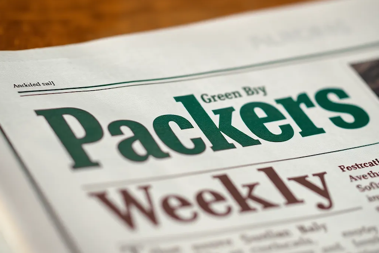

# Resumo Semanal dos Green Bay Packers (27 de Nov, 2025)

Enquanto mergulhamos no espírito festivo, o Green Bay Packers está se preparando para um importante confronto de Ação de Graças contra o Detroit Lions. Esta semana foi repleta de desempenhos interessantes de jogadores, atualizações sobre lesões e preparativos para este confronto divisional. Vamos dar uma olhada nas principais notícias da última semana.

## Emanuel Wilson Brilha como Grande Running Back

Na difícil vitória dos Packers por 23-6 contra o Minnesota Vikings em 24 de novembro de 2025, o running back **Emanuel Wilson** se destacou. Com o titular **Josh Jacobs** fora devido a problemas no joelho, Wilson correu 98 metros e marcou 2 touchdowns, mostrando seu grande potencial como um reserva confiável. O treinador principal Matt LaFleur elogiou sua performance, enfatizando o estilo poderoso de corrida de Wilson e sua habilidade em vencer tackles [Acme Packing Company](https://www.acmepackingcompany.com/green-bay-packers-analysis/75348/emanuel-wilson-rb-new-york-giants-statistics-matchup-results-josh-jacobs-depth-chart).

## Atualizações de Lesões Antes do Dia de Ação de Graças

Enquanto os Packers se preparam para enfrentar os Lions, eles divulgaram seu relatório de lesões. Jogadores importantes como **Quay Walker**, **Savion Williams**, **Lukas Van Ness** e **Karl Brooks** foram descartados. Enquanto isso, **Matthew Golden**, **Keisean Nixon** e **Nate Hobbs** são incertos para o jogo. A equipe também contratou o WR **Will Sheppard** para o elenco ativo após as lesões [Acme Packing Company](https://www.acmepackingcompany.com/green-bay-packers-roster/75562/packers-lions-inactives-6-out-with-injuries-for-green-bay).

## Prévia do Dia de Ação de Graças: Packers vs. Lions

Os Packers enfrentarão os Lions em 27 de novembro às 15h, horário de Brasília. Este confronto é crucial para ambas as equipes na briga pelo título da NFC Norte. No encontro anterior desta temporada, os Packers se saíram bem, derrotando os Lions por 27-13. Uma performance repetida poderia solidificar sua posição na disputa pelos playoffs [Acme Packing Company](https://www.acmepackingcompany.com/green-bay-packers-analysis/75558/packers-lions-preview-what-does-a-detroit-green-bay-win-look-like).

## Principais Confrontos a Observar

### **Desempenho de Jordan Love**
Jordan Love demonstrou um crescimento significativo nesta temporada, destacado por seu jogo eficiente contra os Vikings, onde gerenciou bem a partida mesmo com dor no ombro. Os torcedores dos Packers estarão ansiosos para ver se ele pode reproduzir esse sucesso contra uma defesa dos Lions que, embora forte, é vulnerável ao passe quando pressionada [Acme Packing Company](https://www.acmepackingcompany.com/general/75516/packers-lions-preview-matt-lafleur-needs-to-let-jordan-love-cook-on-thanksgiving).

### **Pressões Defensivas e Turnovers**
A pressão sobre o quarterback dos Lions **Jared Goff** será crucial para os Packers. Goff costuma ter dificuldades quando está sob pressão, como foi visto em seu encontro anterior nesta temporada, quando os Packers o sacked (capturaram) quatro vezes. Se os Packers conseguirem explorar a linha ofensiva desgastada dos Lions, podem forçar turnovers, que são essenciais para a vitória [Cheesehead TV](https://cheeseheadtv.com/blog/packers-need-to-pressure-goff-into-mistakes-350).

## Reconhecimento de Jogadores
**Emanuel Wilson** não somente ganhou atenção por sua performance em campo, mas também foi indicado para o Prêmio FedEx do Jogador do Mês da NFL pelo seu desempenho excepcional. Esse reconhecimento demonstra quão integral ele pode se tornar para o jogo corrido dos Packers no futuro [The Cold Wire](https://www.thecoldwire.com/standout-packers-rb-gets-nominated-for-notable-nfl-award/).

## Conclusão
À medida que os Packers se preparam para enfrentar os Lions em um importante confronto divisional, todos os olhos estarão nas defesas e ataques de ambas as equipes. As atualizações sobre os jogadores, especialmente no que diz respeito às lesões, terão papéis significativos na determinação do resultado deste jogo de Ação de Graças. Os torcedores esperam por uma performance vibrante e, quem sabe, por uma vitória que os impulsione na corrida pelos playoffs.

Vamos lá, Packers! Conseguirão pegar o pedaço da perna de peru neste ano? 🎉

---

### Links para os Principais Posts do Reddit
- [Thread Pré-Jogo de Ação de Graças](https://www.reddit.com/r/GreenBayPackers/comments/1p83kwq/week_13_thanksgiving_pregame_thread_green_bay/)  
- [Thread do Jogo de Ação de Graças: Outras Equipes](https://www.reddit.com/r/GreenBayPackers/comments/1p83phx/week_13_thanksgiving_game_thread_other_teams/)  
- [Uma Mensagem de Micah Parsons](https://www.reddit.com/r/GreenBayPackers/comments/1p86hle/a_message_from_micah_parsons/)  
- [Jordan Love Elogia Wilson](https://www.reddit.com/r/GreenBayPackers/comments/1p7p7t6/jordan_love_is_the_packers_nominee_for_the_2025/)  

### Links para Histórias do Packers.com
- [Detalhes do Packers vs Lions Semana 13](https://www.packers.com/news/packers-vs-lions-week-13-details-game-time-tv-streaming-odds-etc)  
- [Relatório de Lesões para Packers-Lions](https://www.packers.com/news/packers-lions-injury-report-green-bay-makes-4-roster-moves)  
- [Resumo: Packers 23-6 Vikings](https://www.packers.com/news/packers-vikings-game-recap-week-12-2025)  

---

Sinta a empolgação em torno deste confronto de Ação de Graças e vamos torcer para os Packers enquanto eles fazem sua corrida pelos playoffs!
  fileName: post-title-pt.md
