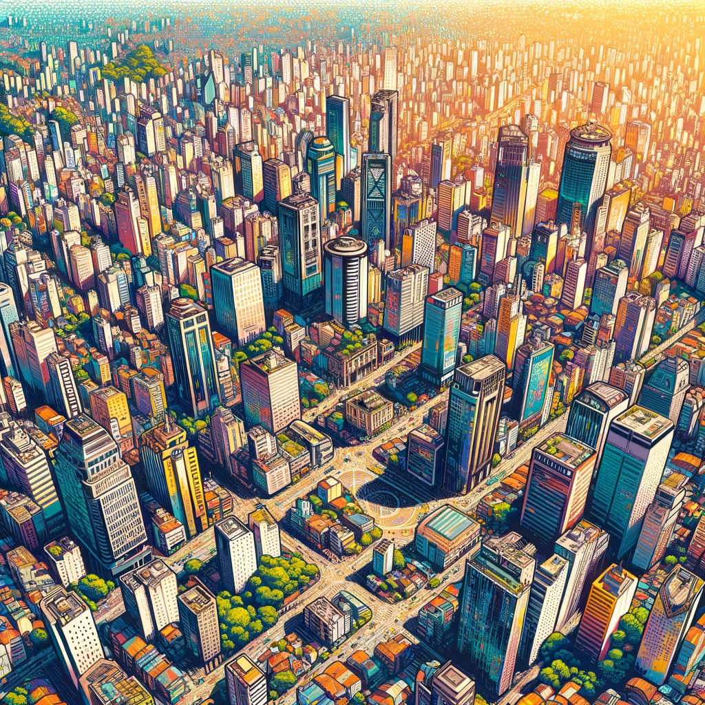
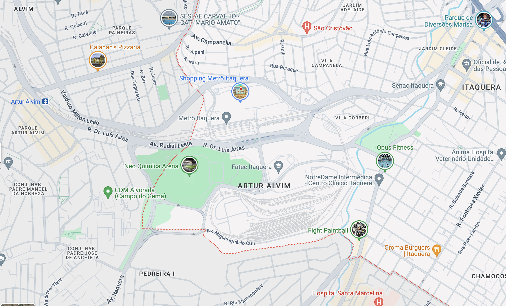
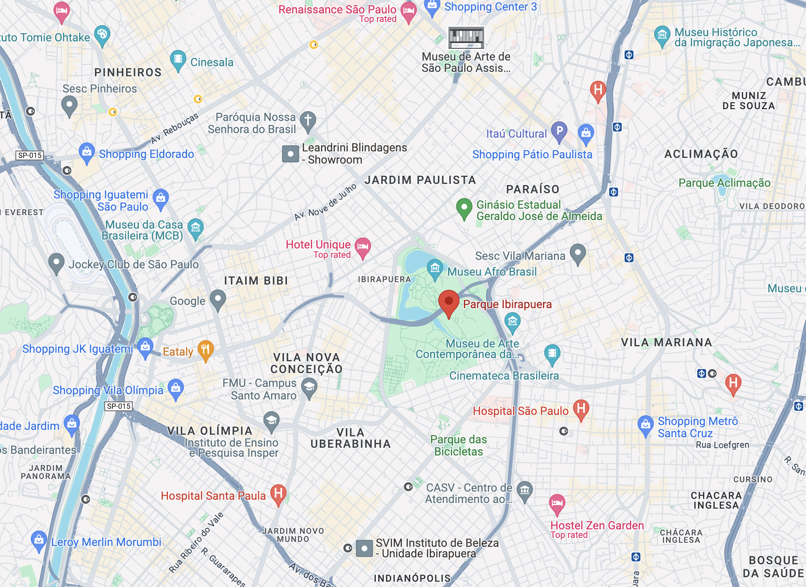

## Introdução Rápida a São Paulo, Brasil
São Paulo é uma cidade com mais de 22,5 milhões de habitantes - quase 2,5x a população de Nova York. Se estendendo por 1.521 km², enquanto Nova York tem 783,8 km². 🤯

Naturalmente, com uma cidade desse tamanho, encontrar um bom bairro para se hospedar pode ser um pouco complicado. Existem, é claro, as redes de hotéis americanas com as quais você já está familiarizado - como Holiday Inn, Radisson ou Renaissance. Você também encontrará uma [grande quantidade de AirBnB's pela cidade](https://www.airbnb.com/s/Sao-Paulo--Brazil/homes?tab_id=home_tab&refinement_paths%5B%5D=%2Fhomes&flexible_trip_lengths%5B%5D=one_week&monthly_start_date=2024-06-01&monthly_length=3&monthly_end_date=2024-08-01&price_filter_input_type=0&channel=EXPLORE&query=Sao%20Paulo%2C%20Brazil&place_id=ChIJ0WGkg4FEzpQRrlsz_whLqZs&date_picker_type=calendar&source=structured_search_input_header&search_type=filter_change&price_filter_num_nights=5&ne_lat=-23.510494766766186&ne_lng=-46.595548967164746&sw_lat=-23.63166153051278&sw_lng=-46.69877349702497&zoom=12.79479972455441&zoom_level=12&search_by_map=true&checkin=2024-09-05&checkout=2024-09-08) com diferentes comodidades. **Aviso** - AirBnB's podem ser um acerto ou erro - então, certifique-se de ler as avaliações e garantir que você está hospedado com um '[Superhost](https://www.airbnb.com/help/article/828)'.

Este guia tem como objetivo contar um pouco mais sobre os diferentes bairros de São Paulo para ajudar você a decidir onde se hospedar para o jogo da NFL aqui.

À medida que a NFL anunciar eventos que ocorrerão pela cidade, atualizaremos este post com bairros próximos a esses locais.

## [Bairro Itaquera](https://www.google.com/maps/place/Itaquera,+S%C3%A3o+Paulo+-+State+of+S%C3%A3o+Paulo,+Brazil/@-23.5339784,-46.4716919,13.93z/data=!4m6!3m5!1s0x94ce66b99a42eac7:0x8ed06d80800b0a3c!8m2!3d-23.5374198!4d-46.4536983!16s%2Fm%2F0fq2p7t?entry=ttu) (mais próximo do Estádio)
A Neo Química Arena, casa do Corinthians, está situada na zona leste de São Paulo, no bairro de Itaquera. É aqui que toda a ação acontecerá na noite de sexta-feira, no jogo entre Green Bay Packers e Philadelphia Eagles. Esta área é principalmente residencial, com uma forte sensação de comunidade, apresentando uma mistura de prédios de apartamentos e casas simples. No entanto, está passando por mudanças devido à construção da Neo Química Arena para a Copa do Mundo FIFA de 2014. A área é conhecida por sua acessibilidade devido às extensas opções de transporte público, incluindo a estação de metrô Corinthians-Itaquera nas proximidades. O bairro também abriga o Shopping Metrô Itaquera, oferecendo aos moradores e visitantes diversas opções de compras e alimentação.

## [Bairro Moema](https://www.google.com/maps/place/Moema,+S%C3%A3o+Paulo+-+State+of+S%C3%A3o+Paulo,+Brazil/@-23.6020717,-46.6768876,17z/data=!3m1!4b1!4m6!3m5!1s0x94ce59f8e9ffac95:0xd02a34bc9438ea3b!8m2!3d-23.6020214!4d-46.6721032!16s%2Fg%2F122tz_58?entry=ttu)
Moema é um bairro sofisticado em São Paulo, conhecido por sua mistura de charme tradicional e comodidades modernas. Caracterizado por ruas arborizadas e uma atmosfera amigável, Moema oferece alta qualidade de vida com sua variedade de restaurantes requintados, boutiques elegantes e bares animados. Recomendamos conferir o Bar do Juarez para Picanha ou o Bar Original para cervejas estupidamente geladas. O bairro é altamente voltado para pedestres, com ciclovias e calçadas bem cuidadas que incentivam caminhadas. Moema também está próxima ao Parque Ibirapuera, um dos maiores e mais populares espaços verdes da cidade, tornando-o uma área desejável para famílias e entusiastas ao ar livre.

## [Bairro Pinheiros](https://www.google.com/maps/place/Pinheiros,+S%C3%A3o+Paulo+-+State+of+S%C3%A3o+Paulo,+Brazil/@-23.5620058,-46.6987426,15z/data=!3m1!4b1!4m6!3m5!1s0x94ce5798cb16268f:0xa94014a3e39a3708!8m2!3d-23.5635787!4d-46.6916068!16s%2Fg%2F155ryzty?entry=ttu)
Pinheiros é um bairro vibrante e eclético em São Paulo, bem diferente de Moema e da área ao redor da Neo Química Arena. Ao contrário de Moema, que é mais residencial e sofisticada, Pinheiros é conhecida por sua vida noturna agitada, galerias vanguardistas e uma cena culinária florescente, oferecendo uma mistura de cozinhas tradicionais brasileiras e internacionais. O bairro também é um polo para indústrias criativas, com inúmeras startups e espaços de coworking. Em contraste com a área perto da Neo Química Arena, mais conhecida pelo estádio e pelos desenvolvimentos associados, Pinheiros possui uma atmosfera cultural mais rica e uma experiência urbana mais dinâmica, tornando-o popular entre os jovens e profissionais. Ele também faz fronteira com o [Beco do Batman](https://www.google.com/maps/place/Beco+do+Batman/@-23.5566009,-46.6891539,17z/data=!3m1!4b1!4m6!3m5!1s0x94ce575858b6a5b9:0xc5b1a9636043ff22!8m2!3d-23.5566009!4d-46.686579!16s%2Fg%2F11b6pwftrw?entry=ttu) - uma famosa galeria de grafite ao ar livre com lojas elétricas.

## Bairros Próximos ao Parque Ibirapuera ([Jardim Paulista](https://www.google.com/maps/place/Jardim+Paulista,+S%C3%A3o+Paulo+-+State+of+S%C3%A3o+Paulo,+Brazil/@-23.5339784,-46.4716919,13.93z/data=!4m6!3m5!1s0x94ce59c2db1faacb:0x186ce70be3f34d44!8m2!3d-23.5739787!4d-46.6606906!16s%2Fg%2F120r00xg?entry=ttu), [Vila Nova](https://www.google.com/maps/place/Vila+Nova+Concei%C3%A7%C3%A3o,+S%C3%A3o+Paulo+-+State+of+S%C3%A3o+Paulo,+Brazil/@-23.5742553,-46.6704143,15z/data=!4m6!3m5!1s0x94ce57575900735f:0xdfe8f65daf38be97!8m2!3d-23.5917828!4d-46.6727333!16s%2Fg%2F121pqdsq?entry=ttu), etc.)
Os bairros ao redor do Parque Ibirapuera em São Paulo estão entre as áreas mais desejadas da cidade, oferecendo uma mistura de conforto residencial e vibração cultural. O Parque Ibirapuera é um vasto oásis verde com inúmeras trilhas, pequenos restaurantes para fazer um lanche e muitos vendedores de Água de Coco. Moema fica diretamente ao sul do parque, conhecida por sua vida sofisticada e ruas amigáveis aos pedestres. Ao norte, você encontrará a Vila Nova Conceição, uma área afluente com propriedades luxuosas e excelentes restaurantes. Jardim Paulista, a oeste do parque, combina uma sensação residencial com dinamismo comercial, abrigando uma variedade de lojas, cafés e atrações culturais. Cada um desses bairros compartilha a proximidade ao Parque Ibirapuera, o que aumenta seu apelo com fácil acesso a um dos maiores espaços verdes da cidade.

## [Bairro Faria Lima](https://www.google.com/maps/place/Av.+Brig.+Faria+Lima,+S%C3%A3o+Paulo+-+SP,+Brazil/@-23.5787618,-46.6897521,15.83z/data=!4m6!3m5!1s0x94ce576d1b6136f3:0xd07acf864bcd7990!8m2!3d-23.5775252!4d-46.6868419!16s%2Fm%2F026wnsp?entry=ttu)
Não recomendamos ficar no bairro Faria Lima para o jogo da NFL - fique nas proximidades, em Pinheiros.

O bairro Faria Lima é conhecido como um centro financeiro, cheio de edifícios comerciais e sedes de grandes corporações. Ele contrasta fortemente com as atmosferas residenciais e de lazer de bairros como Moema. Faria Lima é caracterizado por arquitetura moderna, restaurantes sofisticados e vida noturna vibrante, atendendo a um público profissional. Também apresenta shopping centers de alto padrão e é um ponto-chave para as atividades empresariais da cidade, atraindo profissionais de toda São Paulo. Nas proximidades, o movimentado bairro de Pinheiros adiciona um toque cultural e boêmio, complementando a natureza voltada para negócios de Faria Lima.

## Outros Bairros
Obviamente, com uma cidade tão grande, existem centenas de diferentes bairros na área metropolitana. Como em qualquer viagem, pesquise todas as opções e certifique-se de que atende às suas necessidades. Uma lista curta de outras opções está abaixo:

- [Vila Madalena](https://www.google.com/maps/place/Vila+Madalena,+S%C3%A3o+Paulo+-+State+of+S%C3%A3o+Paulo,+Brazil/@-23.5787618,-46.6897521,15.83z/data=!4m2!3m1!1s0x94ce57be69847fa9:0xd423d197dd9d1e01?entry=ttu) - Conhecida por seu clima boêmio, galerias de arte e vibrante arte de rua. É uma escolha ideal para quem está interessado em vida noturna e cultura local.
- [Higienópolis](https://www.google.com/maps/place/Higien%C3%B3polis,+S%C3%A3o+Paulo+-+State+of+S%C3%A3o+Paulo,+Brazil/@-23.548177,-46.6630061,16z/data=!3m1!4b1!4m6!3m5!1s0x94ce583bf6fab555:0xf467850dd14cd5dd!8m2!3d-23.5457512!4d-46.6599426!16s%2Fg%2F120k19hl?entry=ttu) - Oferece uma experiência mais refinada, com prédios históricos, compras sofisticadas e ruas tranquilas e arborizadas.
- [Bela Vista](https://www.google.com/maps/place/Bela+Vista,+S%C3%A3o+Paulo+-+State+of+S%C3%A3o+Paulo,+Brazil/@-23.5620283,-46.6571093,15z/data=!3m1!4b1!4m6!3m5!1s0x94ce59b756463d61:0x9f3d1e6f7f40964!8m2!3d-23.5554048!4d-46.6456426!16s%2Fg%2F1224122h?entry=ttu) - Localizado próximo ao centro da cidade, esta área é rica em herança italiana e delícias culinárias, tornando-a ideal para entusiastas da gastronomia.
- [Liberdade](https://www.google.com/maps/place/Liberdade,+S%C3%A3o+Paulo+-+State+of+S%C3%A3o+Paulo,+Brazil/@-23.5620283,-46.6571093,15z/data=!4m6!3m5!1s0x94ce59a00cc9896b:0x4d7fa8becba4e40d!8m2!3d-23.5599169!4d-46.6312586!16s%2Fg%2F1233lxsm?entry=ttu) - Conhecido como o bairro japonês, é ótimo para experimentar o aspecto multicultural de São Paulo, com inúmeras lojas e restaurantes asiáticos.

## Como Chegar ao Estádio do Corinthians a Partir do Seu Bairro
A principal maneira que a maioria dos paulistanos usa para ir ao estádio do Corinthians é através do Metrô. A Linha Vermelha pode levá-lo ao centro da cidade para se conectar a outras linhas que o levarão mais perto de seu hotel. Você pode [ler mais sobre diferentes opções de transporte para se locomover em São Paulo aqui](/pt-BR/blog/how-to-get-around-sao-paulo/).
